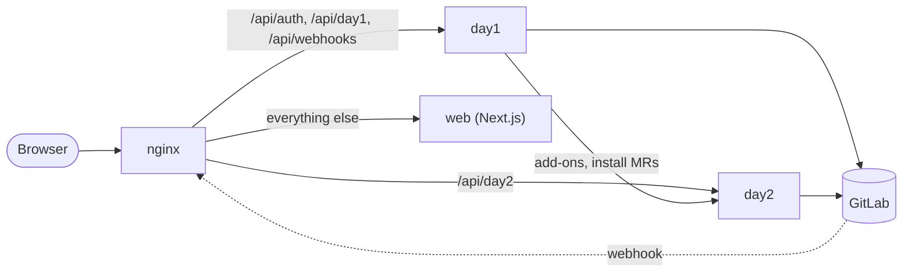
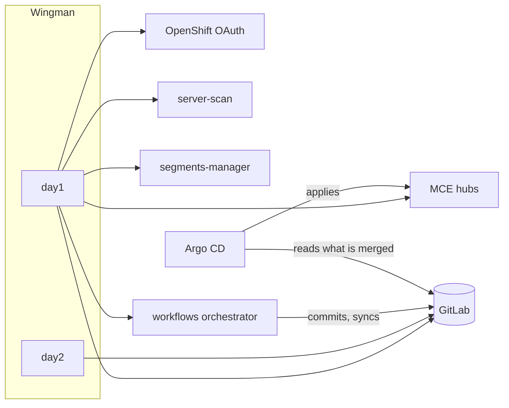
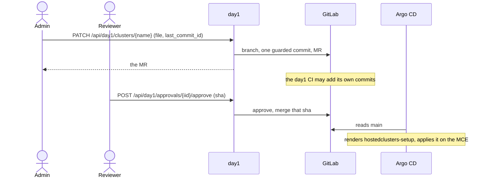

# Architecture

The overview a new developer reads first: the processes, the systems around
them, how a user is known, how the code is layered, and how a read and a write
travel. Each part names the ADR that decided it ([docs/adr/](adr/README.md));
the ADR has the reasons. How the platform around Wingman works is
[docs/ecosystem/README.md](ecosystem/README.md); how the team's architect
divides the work between the systems is
[docs/ideas/architecture-fit.md](ideas/architecture-fit.md).

## The processes

Wingman is four Deployments in one namespace and no database: GitLab is its only
store, and everything else it shows is read from the system that owns it.

| Process | Port | What it does |
|---|---|---|
| nginx | 8080 | The one entry point, behind one Route or Ingress (ADR-0058). It splits the paths above, gzips, holds the timeouts and the body size, passes the status stream through, and answers its own `/healthz`. When day1 or day2 cannot answer, it answers a problem with code `DEPENDENCY_UNAVAILABLE` and the status it met; a service's own answers pass through untouched. |
| web | 3000 | The UI (`apps/web`). Pages run in the browser, which calls `/api/...` by relative paths with TanStack Query. The Next.js server holds no state and never calls the services; `proxy.ts` only redirects on the session cookie (to `/login` without it). |
| day1 | 8001 | `wingman_day1`: hosted clusters, flavors (the specs project), sites and MCEs (read only, ADR-0018), approvals and audit of the day1 and specs projects, login, and every platform system below. |
| day2 | 8002 | `wingman_day2`: add-ons on the hub, MCEs, hosted and UPI clusters (ADR-0020), through the team projects in the sigs group; it reads the day1 project, never writes it. |

day1 calls day2 over HTTP (`DAY2_SERVICE_URL`) for a cluster's installed
add-ons (drift) and for a flavor rollout's install MRs (ADR-0016, ADR-0044),
with a short-lived session token of its own (`infrastructure/day2_client.py`).
day2 calls nothing but GitLab. Health (`/health/live`, `/health/ready`) and
`/metrics` are on each service's own port, which nginx does not route, so they
are reachable inside the cluster only (ADR-0010, ADR-0054). The chart
(`deploy/helm/wingman/`) also renders the OAuth client and the Quick Links
ConfigMap, mounts the MCE tokens Secret into day1, and, off by default, renders
a ServiceMonitor, alerts and a Grafana dashboard (`docs/ops/metrics.md`).

## The systems around Wingman

Only day1 talks to anything but GitLab. Each system it calls has a port, an
adapter and a fake (ADR-0001). server-scan and segments-manager, which each
have an area of their own, are a package each under
`apps/day1-service/src/wingman_day1/integrations/` (ADR-0001's 2026-11-17
amendment); the other adapters are in `wingman_day1/infrastructure/`. All are
built in the composition root (`main.py`, `platform_adapters.py`,
`compose_*.py`, each integration's `compose.py`). Every platform system's
switch is off by default: with all of them off, Wingman needs only GitLab and
OpenShift OAuth.

| System | Adapter | Switch | What Wingman does with it |
|---|---|---|---|
| GitLab | core's `GitLabHttpAdapter` behind `GitLabPort` (ADR-0002); the in-memory fake `InMemoryGitLab`, held to GitLab by the contract suite (ADR-0005) | `GITLAB_URL`, `GITLAB_TOKEN` (required) | Reads every repo; every change is a merge request (below). No other code reaches GitLab. |
| Argo CD | none | none | Nothing: Argo CD reads the merged files and applies them. Each MCE's ApplicationSet makes one Application per cluster file in `hostedClusters/`, rendered by the hostedclusters-setup chart; day2's ApplicationSets find the team repos' folders. Quick Links only links to each Argo CD (ADR-0052). |
| MCE hubs (Kubernetes API) | `hub_api.py` (ADR-0019), a token per hub from `MCE_TOKENS_FILE`, an address by `MCE_API_DOMAIN` or per hub (ADR-0045) | `CLUSTER_STATUS_ENABLED` | Read only: HostedClusters, NodePools and InfraEnvs (live status), each cluster's Machines and Agents (the Nodes tab, ADR-0038), the hub's nodes and pods (MCE placement, ADR-0050). |
| OpenShift OAuth | `openshift_oauth.py` | the OpenShift OAuth settings, or dev login | Login only (below). |
| server-scan | `integrations/server_scan/` (`HttpServerInventory` in `infrastructure/adapter.py`) | `SERVER_SCAN_URL`, with `SERVER_SCAN_TOKEN`, `SERVER_SCAN_ADMIN_TOKEN`, `SERVER_SCAN_AUDITOR_TOKEN` | Its servers on the Nodes tab (ADR-0038), placement's spare servers (ADR-0050), Inventory Management's pools (ADR-0057) and the Server Scan area for admins (ADR-0048). Three writes, from that area, with the admin token: a server's maintenance, Run job and Fetch now (one server read from its vendor manager now; off by default, `DAY1_SERVER_SCAN_REFRESH`). Never `/servers/available` or a reservation: those are the workflows'. The version Wingman matches and how to sync: [integrations/server-scan.md](integrations/server-scan.md). |
| segments-manager | `integrations/segments_manager/` (`HttpSegmentLedger` in `infrastructure/adapter.py`) | `SEGMENTS_MANAGER_URL` | Read only, its open GETs: a cluster's EPG checked against its file (ADR-0039) and the Segments area for admins (ADR-0047). The commit Wingman matches and how to sync: [integrations/segments-manager.md](integrations/segments-manager.md). |
| workflows orchestrator | one adapter per workflow: `workflows_api.py`, `provision_workflow.py`, `upgrade_workflow.py`, `add_server_workflow.py`, `scale_workflow.py` | `WORKFLOWS_API_URL`, plus each workflow's own switch (next table) | Starts a run and shows it in the workflow's words; never re-implements its procedure, checks or phases. The orchestrator has no auth (accepted); day1 lets only admins start a run and logs who did. |
| cluster-navigator | none | none | Not wired. Its data on the cluster page is planned (`docs/ideas/single-pane.md`, workstream 5). |
| herzi | none | none | No adapter: its add-server runs are in the orchestrator's run list, which Inventory Management shows (ADR-0057). |

The workflows Wingman starts. Each switch needs `WORKFLOWS_API_URL`, and
day1 refuses to start without it (ADR-0009):

| Workflow | Switch | Where | ADR |
|---|---|---|---|
| `provision-cluster` | `DAY1_PROVISIONER=workflow` (default `merge-request`) | Create | ADR-0042 |
| `upgrade-cluster` | `DAY1_UPGRADES` | the cluster page, the clusters list | ADR-0055 |
| `uninstall-server-from-hc` | `WORKFLOWS_API_URL` with `SERVER_SCAN_URL` | the Nodes tab | ADR-0038 |
| `add-server-to-mce` | `DAY1_ADD_SERVERS` | Inventory Management | ADR-0057 |
| `update-nodepool` | `DAY1_SCALE_NODEPOOLS` (off by default) | Scale on the Nodes tab | ADR-0062 |
| `delete-cluster` | none: a contract and a panel, 501 until the workflow exists | the delete dialog | ADR-0033 |

`DAY1_FAKE_FLEET` (development only) replaces the MCE hubs, server-scan, the
orchestrator and segments-manager with fakes seeded from `dev/fleet-fixtures/`
(DEVELOPMENT.md). Every call to these systems is counted by `dependency`
(`docs/ops/metrics.md`).

## Who the user is

1. The login page asks `GET /api/auth/config` where to send the browser.
   After the person logs in there, OpenShift's OAuth server sends the browser
   back to `/login` with a code.
2. The page posts the code to `POST /api/auth/callback`. day1 exchanges it for
   an opaque OpenShift token, reads the user and their groups with it once, and
   drops it.
3. The groups give the role: admin (`WINGMAN_ADMIN_GROUPS`) wins over viewer
   (`WINGMAN_VIEWER_GROUPS`); someone in neither is refused, never let in read
   only.
4. day1 issues Wingman's own session token, a short-lived JWT with the
   username, groups and role (`wingman_core.infrastructure.session_tokens`,
   `JWT_EXPIRY_HOURS`). It is signed with `JWT_SECRET_KEY`, which day1 and day2
   share, so either checks it on every request without calling OpenShift or
   each other.
5. The web keeps it in a cookie and sends it as `Authorization: Bearer` on
   every call. Routes take `CurrentUser` (reads) or `AdminUser` (writes) from
   `wingman_core.web.auth`; a few areas are for admins even to read (Segments,
   Server Scan, Quick Links). Nobody approves their own change (`403 SELF_APPROVAL`).

Locally, `DEV_AUTH_ENABLED` with a `DEV_AUTH_SECRET` of 32 or more characters
replaces OpenShift (`POST /api/auth/dev-login`); settings refuse a weak secret.

## The layers

Every package has the same layers, and each may import only the ones before it
(ADR-0001):

| Layer | In core (`wingman_core`) | In a service (`wingman_day1`, `wingman_day2`) | May not import |
|---|---|---|---|
| domain | `domain/`: Git and MR types, `mr_conventions`, users, errors | `domain/`: the rules (names, paths, the cluster file, placement...) | any other layer; httpx, FastAPI, settings, metrics |
| ports | `ports/`: `GitLabPort`, the clock | `ports.py` (day1: `ports/`): the service's own protocols | application, infrastructure, the API; httpx, FastAPI |
| application | `application/`: approvals | `application/`: the use cases, over ports only | infrastructure, observability, the API, settings; httpx, FastAPI |
| infrastructure, observability | the GitLab adapter and fake, `TtlCache`, `RepoSnapshots`, session tokens; metrics, logs | `infrastructure/`: adapters, their fakes, the cached repositories | the application, the API; FastAPI |
| web | `web/`: the app factory, auth, RFC 9457 errors (ADR-0004) | `api/`: the FastAPI routers and their dependencies | an adapter or httpx: the API gets them from the composition root |

day1's external systems with an area of their own are packages under
`wingman_day1/integrations/` (`server_scan/`, `segments_manager/`), each with
the same layers inside: `domain/`, `ports.py`, `application/`,
`infrastructure/` (the adapter, its parser and cache, the fakes), `api/` (the
area's routers and schemas) and `compose.py`; their tests are in
`tests/integrations/<system>/` (ADR-0001's 2026-11-17 amendment). Wingman's
own features that use their data (the Nodes tab, placement, Inventory
Management, a cluster's network check, the Overview) stay in day1's layers and
import an integration's `domain` and `ports` only. The web's counterpart is
`apps/web/features/<area>/` (`api/`, `types/`, `lib/`, `components/`), with
the page routes in `app/` (ADR-0056's 2026-11-17 amendment).

`uv run lint-imports` enforces this with the contracts in `pyproject.toml`
(`[tool.importlinter]`): forbidden contracts for each layer, of day1's and of
every integration's, and an independence contract that keeps the
integrations from importing each other. `scripts/gate.sh python` runs it.
Only `main.py` (and day1's `platform_adapters.py`, `compose_*.py` and each
integration's `compose.py`) builds adapters; day1 never imports day2. A new
external system gets `integrations/<system>/` with a port, an adapter and a
fake; a router never calls a client. Files and functions stay small
(ADR-0056).

## Reads

- **Each repo is read once per commit** (ADR-0035). `RepoSnapshots` checks a
  branch's head once per TTL (`DAY1_CACHE_TTL_SECONDS`, 30 s;
  `DAY2_CACHE_TTL_SECONDS`, 15 s; never over 60, ADR-0011), downloads GitLab's
  archive of that commit once and keeps it until the branch moves. A repo over
  64 MiB, or one GitLab will not archive, is read file by file at the same
  commit. History, MRs and other refs are read call by call and kept for the
  TTL.
- **A read's `last_commit_id` is the commit the repo was read at**, not the
  file's last change. It is a valid write guard; staleness is decided with
  `RepoReads.changed_since`, never by comparing ids.
- **Answered from cache while one fetch refreshes it** (ADR-0041). Past its
  TTL a value is still answered while one background fetch replaces it, never
  older than a minute; a write's invalidation removes it at once. A new
  replica warms its cache at start-up.
- **The cache is per replica** (`TtlCache`, ADR-0011). Wingman's own writes
  clear what they change; day1's GitLab webhook (`POST /api/webhooks/gitlab`,
  `GITLAB_WEBHOOK_SECRET`) clears what a change made in GitLab touched.
- **The platform systems are read through short caches too**: server-scan's
  fleet rows for day1's TTL, a hub's HostedClusters and NodePools and the
  workflow run lists for 10 s, a hub's InfraEnvs for
  `MCE_INFRAENV_CACHE_SECONDS`; one read per replica however many pages are
  open.
- **A failed read is an error, never an empty answer** (ADR-0004): "GitLab
  failed" never shows as "nothing here". Where the time goes, and how to
  measure it: `docs/ops/performance.md`.

## Writes

- **Every change is a merge request** into the day1, specs or a team's
  project: one commit on a new branch from the default branch, authored by the
  person who asked. Branch, title, labels and description follow
  `wingman_core.domain.mr_conventions`, which is a contract (ADR-0007): branch
  `platform/<user>/<action>-<resource>-<UTC stamp>`, title
  `[Wingman/<repo>] <Verb> <type> <name>`.
- **An MR is `(project, iid)`** (`MergeRequestRef`, ADR-0007): day1's routes
  take `?repo=day1` or `?repo=specs`, day2's `(team, iid)`. Nothing takes a
  bare iid.
- **Writes are guarded** (ADR-0006). An update or delete carries the
  `last_commit_id` it was read at, and GitLab refuses it if the file changed
  since (`409 REVISION_CONFLICT`). A merge carries the `sha` the reviewer saw,
  and is refused if the branch moved.
- **Writes are never retried** (ADR-0006). One refused before it was sent is
  `503 GIT_UNAVAILABLE`; one sent and unanswered may have landed and is
  `504 AMBIGUOUS_WRITE`: re-read, do not resend. Workflow starts and
  server-scan's writes follow the same rule.
- **People and automation own different keys** of a cluster file (ADR-0012):
  `vlanId` and `dhcp_values` are the allocate-segment workflow's, `mcFiles`,
  `mcConfigMap` and `tuningConfigmap` the day1 CI's. With `DAY1_UPGRADES` the
  versions are upgrade-cluster's, and with `DAY1_SCALE_NODEPOOLS` an existing
  NodePool's replicas are update-nodepool's. Wingman never writes them, and
  expects their commits on its MR branches. Without
  `DAY1_MULTI_INFRAENV_NODEPOOLS` an edit leaves a nodepool's
  `additionalInfraEnvNames` as it is, and no edit renames a NodePool by its
  InfraEnvs (ADR-0064); no edit changes an existing Replace NodePool's
  `excludeAgentLabels`, which a create writes from
  `DAY1_EXCLUDED_AGENT_LABELS` (ADR-0065).
- **Not every change is Wingman's MR.** Some workflows commit to day1
  themselves (upgrade-cluster and update-nodepool to `main`, allocate-segment
  to an MR's branch); server-scan's maintenance and Run job are server-scan's
  own writes (ADR-0048); segments-manager is never written.

## Three requests, end to end

### An edit becomes an MR, then running config

1. The cluster page reads `GET /api/day1/clusters/{name}`: the file's text,
   its values and the `last_commit_id` it was read at.
2. The admin saves an edit. day1 refuses one that changes automation's keys
   (ADR-0012) or names a tuning profile the day1 repo does not have
   (ADR-0061), then hands the change to the `ClusterProvisioner`
   (`infrastructure/merge_requests.py`, ADR-0017): a branch, one commit guarded
   by `last_commit_id`, the MR. The answer is the MR; nothing has changed yet.
3. The day1 CI runs on the branch and may commit to it.
4. Another admin opens it on Approvals (`GET /api/day1/approvals/{iid}`, with
   its diff and `mr.sha`) and approves: day1 approves and merges exactly that
   sha.
5. Argo CD on the cluster's MCE sees the merged file, renders the chart with
   the layered values and applies the HostedCluster and NodePools; HyperShift
   does the rest. With `CLUSTER_STATUS_ENABLED`, the cluster page reads the
   result from the hub (`GET /api/day1/clusters/{name}/status`, or its stream).

A create is the same with `POST /api/day1/clusters`, unless
`DAY1_PROVISIONER=workflow`: then day1 checks the file as before and starts
provision-cluster, which reserves the segment and opens the MR itself
(ADR-0042).

### A Server Scan page

The Servers page (`/server-scan/servers`, admins) shows server-scan's fleet
table.

1. The browser reads `GET /api/day1/server-scan/servers` every 30 seconds.
2. day1's router checks the admin, and the use case reads the fleet through
   `CachedServerInventory`: one entry per replica for day1's TTL, shared with
   the Nodes tab and Inventory Management, so many open pages are one read.
3. On a miss, `HttpServerInventory` reads the whole fleet from server-scan in
   one call (its `servers/rows`) with the viewer token, sending back
   server-scan's ETag so an unchanged fleet costs a `304`.
4. day1 answers the rows in server-scan's shape with its own weak ETag, and a
   bodiless `304` for a current `If-None-Match`. The page filters, sorts and
   pages them in the browser with server-scan's rules, every filter in the URL.
5. With `SERVER_SCAN_URL` empty the route is `501 FEATURE_DISABLED`; when
   server-scan fails it is `502 DEPENDENCY_UNAVAILABLE`.

### A workflow run: upgrade-cluster

1. An admin's Upgrade asks
   `GET /api/day1/clusters/{name}/upgrade-targets`: a short run of the
   workflow, up to a minute (nginx gives this path a longer timeout).
2. `POST /api/day1/clusters/{name}/upgrade` reaches `HttpUpgradeWorkflow`,
   which posts once to the orchestrator's
   `/workflows/cluster-upgrade/upgrade-cluster` with who asked. It answers
   `202` with the run's id, `upgrade-cluster-<file stem>`: ids are
   deterministic, so a run is found again by its cluster. A run already going
   is `409 UPGRADE_ALREADY_RUNNING`; a start sent and unanswered is
   `504 AMBIGUOUS_WRITE`, never resent.
3. The cluster page reads `GET /api/day1/clusters/{name}/upgrade-run` every
   10 s while the run is open; day1 reads the orchestrator's run by its id and
   shows its phase, what it waits for, its plan and log in the workflow's own
   words. Admins send its decisions (`POST .../upgrade-run/{decision}`); one the
   run refuses is `409 UPGRADE_DECISION_REFUSED`, in its words.
4. The workflow commits the new versions to day1 `main` and syncs the
   cluster's Argo CD Application itself; Wingman sees the commit on its next
   read of the repo.

Every workflow follows this shape: provision-cluster's run is
`provision-cluster-<file stem>` (ADR-0042), the uninstall and add-server runs
show on the Nodes tab and in Inventory Management, and Scale's on the Nodes tab
when it is on.

## Where to go next

- Running it locally, adding an endpoint, testing: [DEVELOPMENT.md](../DEVELOPMENT.md).
- Every route and setting: the root [README.md](../README.md).
- Deploying it: [deploy/helm/wingman/README.md](../deploy/helm/wingman/README.md);
  operating it: [docs/ops/](ops/).
- Every doc, by folder: [docs/README.md](README.md).
